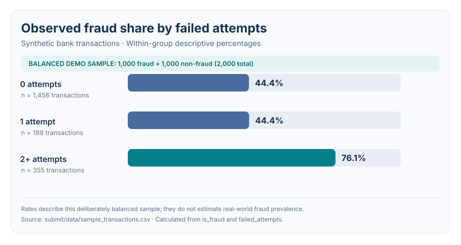

# Exploratory Fraud Risk Patterns

**R · Data Cleaning · Exploratory Data Analysis · Data Visualization**

> **Analytical question:** Which transaction characteristics show higher observed fraud shares, and how can we explore them without confusing a balanced sample with real-world prevalence?



*Figure: calculated from the public **2,000-row balanced synthetic sample**. These percentages describe only that sample, not the fraud rate in a real bank or the full synthetic dataset.*

## At a glance

| | |
| --- | --- |
| **Domain** | Transaction analytics / fraud-risk exploration |
| **Methods** | Data validation, segment-level rates, exploratory charts |
| **Tools** | R, tidyverse, ggplot2, R Markdown |
| **Deliverables** | Reproducible R code, analysis report, data-backed preview |

### What the sample chart shows

In the balanced demonstration sample, the observed fraud share is **44.4%** for zero failed attempts (646/1,456), **44.4%** for one failed attempt (84/189), and **76.1%** for two or more failed attempts (270/355). This illustrates how segment-level percentages can reveal patterns that are obscured by transaction counts. **It does not validate a predictive rule**; the sample is deliberately balanced.

### Key takeaways from the academic study

The original analysis of a larger **synthetic** dataset reported an overall fraud share of **5.53%** and explored associations involving repeated failed attempts, time of day, international status, PIN changes, and merchant categories. Account balance and weekend status were less clearly separated. The study was **descriptive**, not causal or predictive.

## Code and evidence

| Resource | What you will find |
| --- | --- |
| [Standalone R analysis](./analysis/fraud_risk_eda.R) | Short, readable script: required-column checks, group summaries and CSV/chart outputs |
| [Standalone analysis instructions](./analysis/README.md) | Local setup and expected output files |
| [Academic R Markdown](./submit/Exploratory_Fraud_Risk_Patterns.Rmd) | Original full EDA and figure-generation workflow |
| [Academic paper PDF](./submit/Exploratory_Fraud_Risk_Patterns.pdf) | Report with methodology, discussion and limitations |
| [Synthetic sample CSV](./submit/data/sample_transactions.csv) | Balanced 2,000-row demonstration dataset |

### Run the short analysis

From the repository root, after installing the R packages `readr`, `dplyr`, `ggplot2`, and `scales`:

```bash
Rscript analysis/fraud_risk_eda.R
```

This creates descriptive summaries and a local chart in `outputs/`. The script has been run successfully by the repository owner on macOS. The full academic report uses a separate workflow and full synthetic dataset that is **not packaged** here.

## Limitations & responsible interpretation

- The data are **synthetic**, not real banking transactions.
- The included 2,000-row sample is **balanced by design** (1,000 fraud and 1,000 non-fraud cases). Its rates cannot estimate underlying prevalence.
- Group differences are exploratory associations; **no validated classifier, train/test evaluation, or causal identification** is claimed.
- The larger synthetic-data results and the demonstration sample must not be mixed.

## Project credits

Original academic research and paper: **Ngoc Khanh Vy Huynh and Keyao Li**. This portfolio page highlights the exploratory approach and a standalone demonstration.

---

[Back to Data Analyst portfolio](https://github.com/vyhuynh071200)
